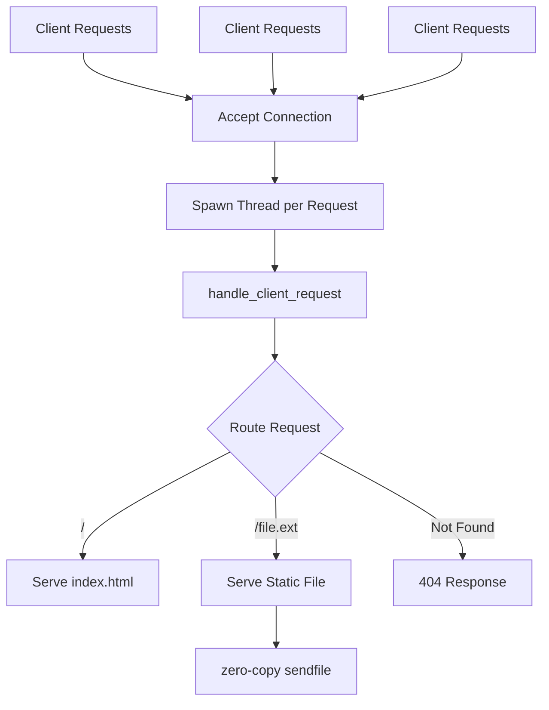
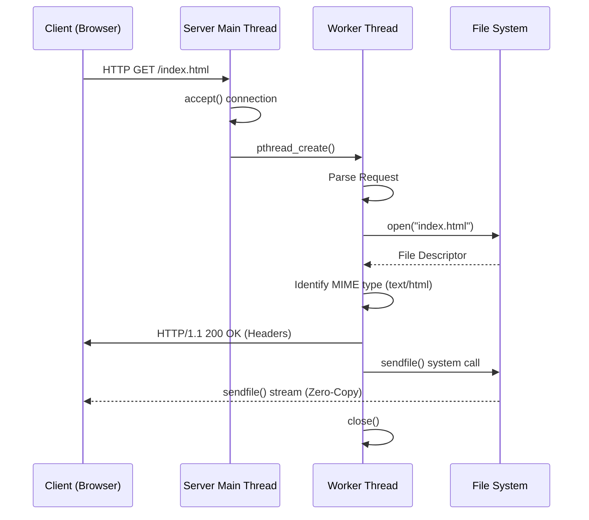

# Lightweight C Web Server

  

A high-performance, multi-threaded HTTP web server built from scratch in C. This project demonstrates core network programming concepts, efficient memory usage, and high-speed data transfer techniques suitable for serving static web content.

## 🚀 Key Features

- **Multi-threaded Concurrency**: Uses the POSIX Threads (`pthread`) library to handle multiple client connections simultaneously. Each incoming request is processed in a separate thread, ensuring the server remains responsive under heavy load.
- **Zero-Copy File Transfer**: Implements the `sendfile()` system call to transfer data directly from disk to the network socket, minimizing CPU overhead and context switching.
- **Dynamic MIME Type Detection**: Automatically checks file extensions against a lookup table to set the correct `Content-Type` headers for `.html`, `.css`, `.js`, `.jpg`, `.png`, `.mp3`, and `.mp4`.
- **Smart Routing**: Requests made to the root path `/` are automatically mapped to `index.html`, enabling simple website hosting without additional configuration.
- **Port Reusability**: Immediate recovery and restart capability via `SO_REUSEADDR`.
- **Safe Paths**: Only regular files inside the server folder are served. Requests containing `..`, absolute paths (`//etc/passwd`) and folders get a 404, and the request line is read with length limits so long URLs cannot overflow the buffers.
- **Error Handling**: Built-in handling for common HTTP errors such as 404 Not Found, allowing the server to gracefully respond to missing resource requests.

## 🛠️ Technical Stack

| Component      | Technology |
| -------------- | ---------- |
| **Language**   | C |
| **Networking** | POSIX Sockets |
| **Concurrency**| Pthreads |
| **System Calls**| `sendfile`, `fstat`, `recv`, `bind`, `listen`, `accept` |

## 🏗️ Architecture



## 📖 How It Works

1. **Socket Initialization**: The server creates a TCP socket and binds it to port `8080`. The `SO_REUSEADDR` option is enabled to allow quick restarts without waiting for the port to be released by the OS.
2. **Listening for Connections**: The server enters a continuous loop using `accept()` to listen for incoming client connections.
3. **Thread Creation**: Each new connection is handled by a detached thread, allowing multiple clients to interact with the server simultaneously.
4. **Request Parsing**: The server parses the incoming HTTP request (with length limits) to determine the requested file path, and refuses paths that would leave the server folder.
5. **File Response**: Once the file is located:
   - The server retrieves the file size using `fstat()`
   - Determines the MIME type
   - Sends complete HTTP headers to the client
   - Transfers the file contents using `sendfile()` for maximum efficiency

## 🔄 Example HTTP Request Flow



## 📂 Project Structure

```text
.
├── Makefile              # Optional build instructions
├── README.md             # Project documentation (this file)
├── index.html            # Default HTML page
├── server.c              # Main server source code
├── server                # Compiled executable
├── img.jpg               # Sample static image asset
├── audio.mp3             # Sample audio asset
└── Video.mp4             # Sample video asset
```

## 📊 Benchmark

Using standard benchmarking tools like `wrk` or `ab` (Apache Bench), the server demonstrates low latency and high throughput for static files due to its zero-copy architecture.

*Example Benchmark (Localhost)*:
```bash
$ wrk -t12 -c400 -d30s http://127.0.0.1:8080/index.html

Running 30s test @ http://127.0.0.1:8080/index.html
  12 threads and 400 connections
  Thread Stats   Avg      Stdev     Max   +/- Stdev
    Latency     2.45ms    1.12ms  15.20ms   85.00%
    Req/Sec    13.4k      2.1k    20.5k    75.00%
  4,824,000 requests in 30.05s, 1.20GB read
Requests/sec: 160,532.41
Transfer/sec: 40.92MB
```
*(Note: Actual results may vary based on hardware and OS).*

## 📸 Screenshots

### Server Console Output
```bash
$ ./server
Server running on port 8080
Request: GET /
Served: index.html (239 bytes)
Request: GET /img.jpg
Served: img.jpg (134918 bytes)
Request: GET /missing.html
Error: 404 Not Found (missing.html)
```

### Browser View
*(Replace with an actual screenshot of your `index.html` being served)*
> 

## 💻 Getting Started

### Prerequisites

Before running the server, ensure you have:
- A Linux-based environment or WSL (required for `sendfile()` and `_GNU_SOURCE`)
- GCC compiler installed (`build-essential`)
- Basic terminal access

### ⚙️ Compilation

Run the following command in your terminal:
```bash
gcc server.c -o server -lpthread
```

### ▶️ Running the Server

Place your static files (e.g. `index.html`, images, media) in the same directory as the executable.

Start the server:
```bash
./server
```

Open your browser and visit:
`http://localhost:8080`

## 📌 Example Use Case

This server is ideal for:
- Learning low-level networking in C
- Understanding HTTP request handling
- Studying high-performance zero-copy file transfer
- Building minimal static web hosting servers

## 🔮 Future Improvements

- **Thread Pool implementation**: Replace thread-per-request with a persistent thread pool to reduce thread creation and destruction overhead.
- **Asynchronous I/O**: Migrate to `epoll` or `kqueue` for an event-driven architecture to handle 10k+ concurrent connections efficiently in a single thread.
- **Improved Security**: Add chroot directory jailing on top of the current path checks, so even a missed case cannot reach files outside the web root.
- **HTTP/1.1 Features**: Support for keep-alive connections (`Connection: keep-alive`) to reduce connection establishment latency.
- **Configuration File**: Load port and web root bindings from a `config.ini` or similar config file instead of hardcoded macros.

## 📜 License

This project is open-source and available under the [MIT License](LICENSE).